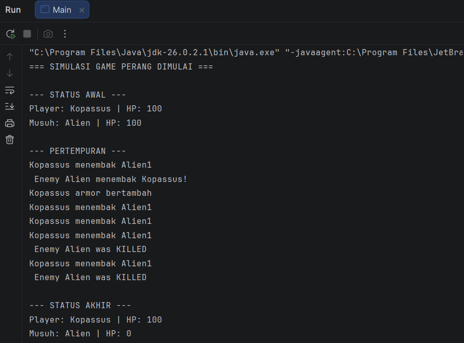

Tugas Responsi Akhir Praktikum PBO

1. Identitas Mahasiswa dan Tema
Nama: Marcell Dwi Alansyah
NIM: H1D025130
Tema Sistem: Game 

2. Petunjuk Compile dan Run (Melalui Terminal)
Untuk menjalankan program ini melalui terminal atau command prompt, ikuti langkah-langkah berikut:

    1.	Buka terminal dan masukin direktori ke tempat Anda menyimpan source code ini. 
    2.	Lakukan kompilasi semua berkas .java dengan menjalankan perintah:
    •	javac *.java
    3.	Setelah kompilasi berhasil (tidak ada pesan error), jalankan class Main dengan perintah: 
    •	java Main

3. Screenshot Luaran Program
Berikut adalah tangkapan layar main dari hasil eksekusi program (output terminal):
 

